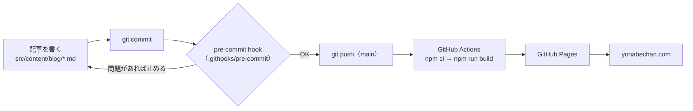

# yonabechan-blog

個人ブログ [yonabechan.com](https://yonabechan.com) のソースです。
[Astro](https://astro.build/) で静的サイトを生成し、`main` に push すると GitHub Actions がビルドして GitHub Pages に公開します。

## 構成



- **記事**：新しい記事は Markdown で書きます。Astro 導入前の記事は HTML のまま `public/posts/` に置いていて、書き換えません。
- **一覧**：トップと記事一覧は、HTML 記事と Markdown 記事を合わせて新しい順に自動で並べます。
- **公開**：`.github/workflows/deploy.yml` が `main` への push でビルドし、`dist/` を GitHub Pages に公開します。外部の Action はコミットの SHA で固定しています。

## ディレクトリ

| 場所 | 中身 |
|---|---|
| `src/content/blog/` | Markdown の記事（ファイル名が URL になる：`/posts/<ファイル名>.html`） |
| `src/pages/` | トップ・記事一覧・Markdown 記事のページ |
| `src/layouts/` | 共通のヘッダー・フッターと記事のレイアウト |
| `src/lib/posts.ts` | HTML 記事と Markdown 記事を集めて並べる処理 |
| `public/` | そのまま配信するファイル（既存の HTML 記事・CSS・画像・CNAME） |
| `.githooks/` | pre-commit hook |

## 記事の書き方

`src/content/blog/YYYY-MM-DD-<slug>.md` を作り、先頭に次の front matter を書きます。

```yaml
---
title: 記事のタイトル
date: 2026-12-01
description: 一覧や検索結果に出る説明文
tags: [Astro, GitHub Actions] # 省略可
draft: true # 公開するときに false にする（省略するとビルドエラー）
---
```

`draft: true` の記事はビルドに含まれず、公開されません。`npm run dev` では「下書き」と表示して確認できます。

記事の図は `.drawio.svg`（または SVG）を `public/img/` に置き、`` で参照します。記事の中に Mermaid のコードは書きません。

## 開発

```sh
npm ci          # 依存関係を入れる
npm run dev     # ローカルで確認する（http://localhost:4321/）
npm run build   # 公開と同じビルドを手元で試す（dist/ に出力）
```

## 公開前の安全装置

commit のたびに pre-commit hook が次を確認します。clone したら一度だけ有効にしてください。

```sh
git config core.hooksPath .githooks
```

- commit の作者メールアドレスが GitHub の noreply アドレスでなければ止める
- 画像から位置情報などのメタデータを消す（exiftool）
- アクセスキーなどの秘密情報が含まれていれば止める（gitleaks。無ければ簡易パターン）
- `.env` や鍵のファイルを止める
